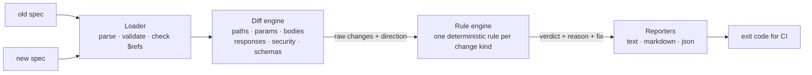

# ContractGuard

**Catch breaking API changes before your consumers do.**

ContractGuard compares two versions of an OpenAPI 3.x contract and tells you, change by change, whether existing clients will break, why, and how to ship the change safely. It runs as a CLI and fails CI when a pull request breaks the contract.

```text
$ contractguard check orders-v1.yaml orders-v2.yaml

ContractGuard compatibility report
12 breaking · 4 need review · 6 safe

✖ BREAKING GET /orders/{id}
  Response property `total` removed (looks renamed to `amount`)
  at:   response 200 (application/json) → total
  why:  Clients that read this property will get undefined/null and may fail.
  fix:  Return both `total` and `amount` during a transition period (mark `total`
        `deprecated: true`), then remove it once consumers have migrated.

✖ BREAKING GET /health
  Endpoint now requires authentication
  at:   security
  why:  Anonymous clients will be rejected with 401. Now required: `bearerAuth`.
  fix:  Keep the endpoint public (`security: []`), or roll out authentication behind a new version.

▲ REVIEW   GET /orders/{id}
  New response enum value(s): `refunded`
  at:   response 200 (application/json) → status
  why:  Clients with exhaustive enum handling (Swift, Kotlin and Dart enums, `switch`
        with no default) may crash on an unknown value.
...
```

## The problem

A backend developer renames `total` to `amount` in `GET /orders/{id}`. The server's tests pass and the deploy is green. Meanwhile, every mobile app already installed on users' phones still reads `total` and starts failing.

The backend team can't catch this with their own tests, because those tests use the new contract. It is a **compatibility** problem: you need to compare the new contract with the old one, from the consumer's point of view.

## Quick start

Requires Node.js 20 or later.

```bash
git clone https://github.com/Israa-e/contractguard && cd contractguard
npm install    # also builds dist/
npm run demo   # compares examples/orders-v1.yaml → examples/orders-v2.yaml
```

To put the `contractguard` command on your PATH, run `npm link` from the clone. Then:

```bash
contractguard check <old-spec> <new-spec> [options]
contractguard check --base <git-ref> <spec> [options]   # old spec = <spec> at a commit, branch or tag
```

| Option | Default | Description |
|---|---|---|
| `--base <git-ref>` | | Compare `<spec>` with its version at `<git-ref>` instead of with a second file |
| `-f, --format <text\|markdown\|json>` | `text` | Output format |
| `--fail-on <breaking\|review\|never>` | `breaking` | Exit with code 1 when changes at or above this severity are found |
| `--hide-safe` | off | Leave safe changes out of text/markdown output |
| `--no-color` | off | Disable colored output |
| `-h, --help` / `-v, --version` | | Show help / version |

| Exit code | Meaning |
|---|---|
| `0` | Compatible under the `--fail-on` policy |
| `1` | Incompatible changes found |
| `2` | Invalid usage or unreadable/invalid spec |

### In CI

Copy [`docs/github-action-example.yml`](docs/github-action-example.yml) into the repository that owns the API. On every pull request it runs `contractguard check --base "origin/$BASE_REF" openapi.yaml`, fails the check on breaking changes, and writes a Markdown report to the job summary.

`--base` reads the old spec with git (`rev-parse` + `cat-file`), without changing the working tree or index. The ref must exist locally, so check out with `fetch-depth: 0`: the default shallow checkout doesn't fetch the base branch, and ContractGuard then exits with code `2` and says so. An unknown ref, a spec missing at the ref, or running outside a git repository also exit with `2`, never with a compatibility verdict.

This repository runs ContractGuard against its own example in [CI](.github/workflows/ci.yml) and asserts that the breakage is caught.

## How it works



The core design decision: **the diff engine records what changed and the direction the data flows; the rule engine decides what that means.**

The same edit has opposite consequences depending on direction:

| Change | In a **request** (client → server) | In a **response** (server → client) |
|---|---|---|
| Property removed | 🟡 review: client's data is silently ignored | 🔴 breaking: client reads a missing field |
| Required property added | 🔴 breaking: old clients don't send it | 🟢 safe |
| Property becomes optional | 🟢 safe | 🔴 breaking: client assumed it's always there |
| Type `integer` → `number` | 🟢 safe: accepts more | 🔴 breaking: client may receive `1.5` |
| Becomes nullable | 🟢 safe | 🔴 breaking: client may crash on `null` |
| Enum value added | 🟢 safe | 🟡 review: exhaustive `switch`/enum deserializers |
| Enum value removed | 🔴 breaking | 🟢 safe |
| `maxLength` reduced | 🔴 breaking: valid input now rejected | 🟢 safe |
| `minimum` lowered | 🟢 safe | 🟡 review: clients may get unexpected values |

Most "JSON diff" approaches get half of this table wrong, because they treat changes symmetrically.

### What it checks

- **Endpoints:** removed/added operations, deprecations, `operationId` changes (these break generated SDKs).
- **Parameters:** new required params, optional → required, removals, schema changes. Path params match by position, so `{id}` → `{orderId}` isn't reported. Header names match case-insensitively. Operation-level params override path-level ones.
- **Request bodies:** body added or made required, content types dropped.
- **Responses:** success codes removed or changed (e.g. `200` → `201`), new status codes, content types dropped.
- **Security:** modelled as sets of alternatives with scopes. A change is breaking only if a client satisfying an old requirement no longer satisfies any new one. Relaxations are flagged for review because they may expose data.
- **Schemas, recursively:** properties, required fields, types (`integer` ⊂ `number`), nullability (3.0 `nullable` and 3.1 `type: [.., null]`), enums and `const`, numeric/length/item bounds, `pattern`, `format`, `additionalProperties`, `readOnly`/`writeOnly`, `allOf` (intersected: the strictest bound wins, and a property declared in several branches combines them), `oneOf`/`anyOf` (branch-wise), arrays, `$ref`s (in 3.1, keywords next to a `$ref` apply too), and recursive schemas.
- **Rename hints:** a removed property paired with exactly one added property of identical shape is reported as a likely rename, with a migration suggestion.

## Severity levels and assumptions

| Severity | Meaning |
|---|---|
| 🔴 **breaking** | Existing consumers that follow the old contract will fail. |
| 🟡 **review** | May break some consumers. ContractGuard cannot prove it's safe, so it says so instead of guessing. |
| 🟢 **safe** | Backwards compatible for consumers that follow the contract. |

ContractGuard assumes consumers are **tolerant readers**: they ignore response fields they don't know. Under that assumption, adding a response field is safe. A client with a strict deserializer that rejects unknown fields would still break, and the report says so.

## Limitations

These are deliberate scope decisions for v0.1, not oversights:

- **The contract, not the implementation.** If the server changes behaviour without changing the spec, ContractGuard can't see it. Pair it with contract tests (e.g. Schemathesis, Pact) to check the implementation against the spec.
- **Local `$ref`s only.** Multi-file specs must be bundled first (e.g. `redocly bundle`).
- **Structural checks only.** The loader rejects malformed parts the comparison reads (operations, parameters, request bodies, responses, `security`) with exit code `2`, but it is not a full OpenAPI validator. Lint specs separately (e.g. `redocly lint`).
- **OpenAPI 3.0 and 3.1.** Swagger 2.0 is rejected with conversion guidance.
- **`--base` compares with the ref itself, not a merge base,** and needs the spec at the same path there (renames aren't followed). For a merge base, pass it explicitly: `--base "$(git merge-base origin/main HEAD)"`.
- **`oneOf`/`anyOf` are compared by branch position.** If the number of branches changes, the change is flagged for review rather than analysed.
- **Not yet checked:** response headers, `discriminator` mappings, callbacks/webhooks, security scheme definitions themselves (only which schemes are required), and parameter `style`/`explode`.

## Project layout

```text
src/
  loader.ts          parse YAML/JSON, validate the OpenAPI version, resolve every $ref up front
  git.ts             --base: read a spec at a git ref without touching the working tree
  validate.ts        reject malformed structures the comparison reads, with the exact location
  refs.ts            JSON-pointer $ref resolution and circular-alias detection
  diff/spec.ts       endpoint-level diff: paths, params, bodies, responses, security
  diff/schema.ts     direction-aware recursive schema diff
  rules.ts           change kind → severity + reason + suggested fix
  report/format.ts   text / markdown / json output
  cli/run.ts         argument parsing and exit codes (pure, testable)
  bin.ts             process entry point
test/                133 tests: every schema rule in both directions, operations, CLI, loading
examples/            a realistic v1 → v2 migration of a delivery orders API
```

## Development

```bash
npm test            # vitest
npm run typecheck
npm run build       # → dist/
npm run test:pack   # pack, install into an empty project, run the CLI and library
```

Use it as a library too:

```ts
import { compareFiles, compareText, compare } from 'contractguard';

const report = await compareFiles('old.yaml', 'new.yaml'); // load YAML/JSON files
report.summary;   // { breaking: 12, review: 4, safe: 6 }
report.changes;   // [{ kind, severity, endpoint, location, message, reason, suggestion }]

compareText(oldYaml, newYaml); // in-memory YAML/JSON strings
compare(oldDoc, newDoc);       // already-parsed OpenAPI objects
```

## Roadmap

- [x] `--base <git-ref>`: read the old spec straight from git
- [ ] Config file: ignore specific changes with a required justification (an audit trail for accepted breakage)
- [ ] Response headers and `discriminator` support
- [ ] External `$ref` bundling
- [ ] Post the report as a pull request comment
- [ ] Benchmark on large real-world specs (Stripe, GitHub)

## License

MIT
